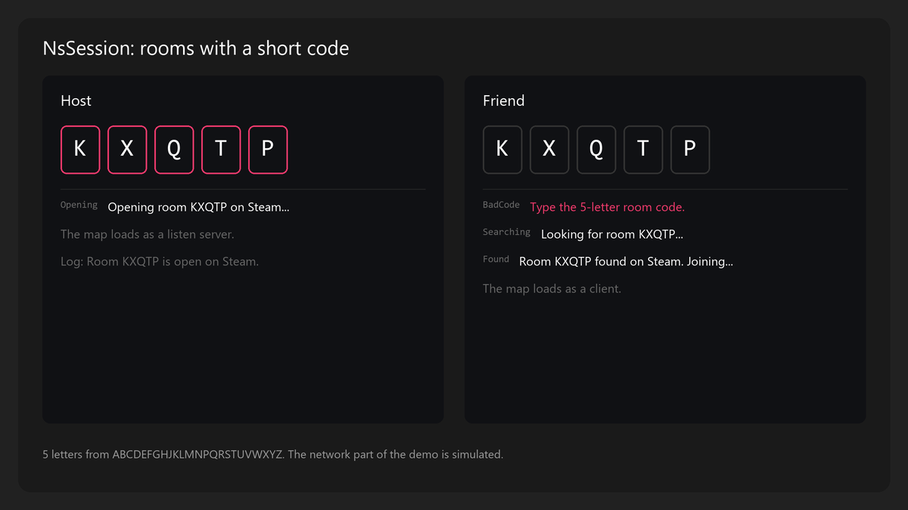

# NsSession User Guide

## Purpose

NsSession gives multiplayer rooms with a 5-letter code, like KXQTP. The host opens a map and gets a code. A friend types the code and joins. A room is a Steam lobby when Steam runs, and a LAN session in other cases. When the nearby Steam search finds nothing, a second search looks in every region.

NsSession has no UI, no session browser, no player names, and no map setting. Your game gives the map, shows the status lines, closes its menus, and opens the title map after a leave.

[](Showcase/RoomCodes.html)

## Setup

1. Copy the `NsSession` folder into the `Plugins` folder of your project.
2. Open the project and enable NsSession in **Edit > Plugins**. It also enables `OnlineSubsystem`, `OnlineSubsystemUtils`, and `SteamSockets`.
3. For C++, add `"NsSession"` to the dependencies of your game module in `Build.cs`.
4. Restart the editor.

For Steam rooms, also do these steps:

1. Enable the engine plugin `OnlineSubsystemSteam` in your project.
2. Set up Steam and the Steam net driver in `DefaultEngine.ini`.
3. In `DefaultEngine.ini`, set the connection class of the Steam net driver:

```ini
[/Script/SteamSockets.SteamSocketsNetDriver]
NetConnectionClassName="/Script/NsSessionSteam.NsSteamNetConnection"
```

Steam rooms work on Win64 only. Other platforms use LAN rooms.

## Quick Start

1. Make a widget with a **Host** button, a text box for the code, a **Join** button, and a status text.
2. In the widget graph, call `Get Ns Session Subsystem`.
3. On **Host**, call `Host Room` and pick your gameplay map in the **Map** pin.
4. On **Join**, call `Join Room` with the text of the code box.
5. On **Event Construct**, bind `On Room Status`. In the event, set the status text to `Get Status Text` of the status.
6. Show `Get Room Code` in the HUD of the host.
7. Set the Play In Editor options to 2 players and **Play Standalone**.
8. Press Play. Host on one window, and join with the code on the other.

In C++:

```cpp
#include "NsSessionSubsystem.h"

// RoomMap is a TSoftObjectPtr<UWorld> property of the menu.
void UMyMenu::Host()
{
    UNsSessionSubsystem::Get(this)->HostRoom(RoomMap.ToSoftObjectPath());
}

void UMyMenu::Join(const FString& Code)
{
    UNsSessionSubsystem::Get(this)->JoinRoom(Code);
}

// Bound to OnRoomStatus. OnRoomStatus is a dynamic event, so this handler is a UFUNCTION.
void UMyMenu::HandleRoomStatus(const FNsRoomStatus& Status)
{
    StatusText->SetText(Status.GetDefaultText());
}
```

## Common Tasks

### Host a room

1. Call `Host Room` with the map of the room.
2. Read the return value. False means that the host did not start.

The subsystem makes a new code and opens the map as a listen server. After the map loads, it creates the session that carries the code. Blueprint shows two `Host Room` nodes. The node with a **Map** pin of type World gives a map picker.

### Join a room

1. Call `Join Room` with the code that the player typed.
2. Bind `On Room Status` to show the progress.

The code is not case sensitive, and spaces at the start and end do not count. The join searches LAN and Steam at the same time, and joins the first room with the code.

### Show the room code in the HUD

1. Call `Get Room Code`. It is empty when this machine is not in a room.
2. Call `Get Room Network` to show `Lan` or `Steam`.

### Show the status

1. Bind `On Room Status`, or call `Get Last Status Text` each frame.
2. Read **Failed** of the status. True means that the host or the join stopped.

For your own text, read **Status** of the status and pick your own line. `Get Status Text` gives the default English line.

### Close the menus when the room opens

1. Bind `On Room Entered`.
2. In the event, close the menus.

`On Room Entered` fires each time a map loads as a listen server or as a client.

### Leave a room

1. Call `Leave Room`.
2. Open your title map.

`Leave Room` stops the searches and ends the session on this machine. It does not open another map.

### Show why a player came back to the title

1. In the title menu, call `Consume Last Failure`.
2. When it returns true, show `Get Status Text` of the status.

It gives the failure of a lost connection (**Host Left** or **Connection Failed**) one time.

### Test without Steam

1. Start the game with the `-lanroom` command line option.

Play In Editor always uses LAN. Each Play In Editor window has its own LAN session.

### Join an address directly

1. Call `Join Direct Address` with an address, for example `127.0.0.1`.

This is for tests. It uses no code and no session.

## Settings

`UNsSessionSubsystem` reads these values from `Config/DefaultGame.ini`. They do not show in the editor.

```ini
[/Script/NsSession.NsSessionSubsystem]
GameTag=MyGame
MaxPlayers=6
```

| Setting | Default | Effect |
|---|---|---|
| `GameTag` | Empty (uses the project name) | Marks the rooms of this game. A search finds only rooms with the same tag. |
| `MaxPlayers` | 6 | Players in one room, host included. |

Give each game its own `GameTag` when two games share one Steam app ID, such as the Spacewar test app.

## Debug

The plugin has no console commands or console variables.

| Tool | Use |
|---|---|
| `LogNsSession` | Each status line, the session creation, a search that cannot start, and each join address. |
| `LogNsSessionSteam` | A closed connection when another connection from the same Steam ID stays open. |
| `-lanroom` | Use LAN rooms with Steam running. |
| `Can Use Steam` | True when this machine can host and search Steam rooms. |
| `Is Searching` | True while the LAN or Steam join search runs. |

## Troubleshooting

| Problem | Cause | Fix |
|---|---|---|
| `Host Room` or `Join Room` returns false with no status. | A join search runs, or a host waits for its map. | Wait for the end, or call `Leave Room` first. |
| Status **No Map**. | The map is empty. | Pass a map to `Host Room`. |
| Status **Map Missing**. | The map is not in the build. | Add the map to the maps to package. |
| Status **Bad Code**. | The code does not have 5 letters from the code alphabet. | Type the 5 letters again. The codes have no I and no O. |
| Status **Search Failed**. | No session interface can search. | Make sure that the online subsystem loads. |
| Status **Not Found**. | No room has the code and the game tag. | Check the code, and make sure that both games use the same `GameTag`. |
| Status **Room Full**. | The room has `MaxPlayers` players. | Raise `MaxPlayers` on the host. |
| Status **No Controller**. | The join found the room but no local player controller. | Join from a world with a local player. |
| A host gets no code, and the log says "Players can join by IP address only." | The session could not be created. | Check the online subsystem setup in `DefaultEngine.ini`. |
| A Steam host crashes when a player reconnects. | The Steam net driver does not use `NsSteamNetConnection`. | Set `NetConnectionClassName` as in [Setup](#setup). |
| The game always uses LAN. | Play In Editor, `-lanroom`, or no Steam login. | Test a packaged game with Steam running. |

## Limits

- One room for each game instance.
- No session browser. A player needs the code.
- Play In Editor and `-lanroom` always use LAN.
- Steam rooms and the worldwide search work on Win64 only.
- `Leave Room` does not open another map.
